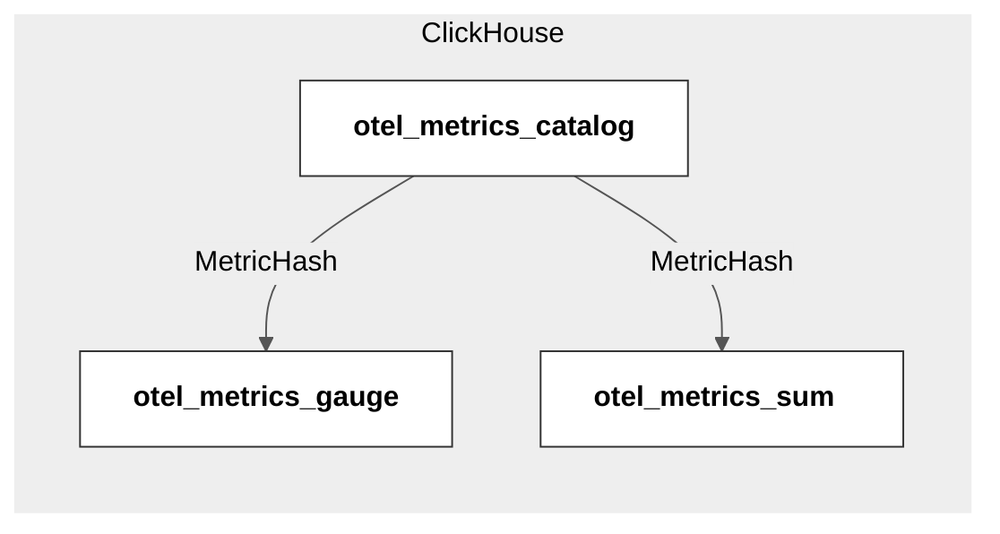
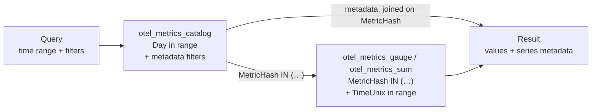

# OTLP Metric Storage

A gRPC backend that receives OpenTelemetry metrics (OTLP) and stores them in ClickHouse.

- Assignment: [`docs/INSTRUCTION.md`](docs/INSTRUCTION.md)
- Design decisions: [`docs/ADR-Home-Assignment.md`](docs/ADR-Home-Assignment.md)

## Running it

Requirements: Go 1.26+ and Docker.

### Quick demo

```shell
make demo
```

```text
telemetrygen ──OTLP gRPC :4317──▶ service ──native protocol :9000──▶ ClickHouse
                                     │                               catalog, gauge, sum
                                     └──OTLP gRPC :18889──▶ Aspire Dashboard (UI :18888)
```

The script starts ClickHouse, the Aspire Dashboard (a local OTLP viewer) and the service. It sends Sum and Gauge datapoints for two services, plus Histogram datapoints that the service rejects. Then it prints the stored values. It takes about 15 s. The service keeps running until Ctrl+C, so you can look at its metrics in the dashboard.

### Step by step

**1. Start ClickHouse** (and the Aspire Dashboard, to see the service metrics):
```shell
docker compose --profile observability up -d
```

**2. Run the service.** It creates the tables at startup.
```shell
make run
```

| Flag | Default | Description |
| --- | --- | --- |
| `-listenAddr` | `localhost:4317` | OTLP gRPC listen address |
| `-maxReceiveMessageSize` | `16777216` | Max gRPC message size in bytes |
| `-clickhouseAddr` | `localhost:9000` | ClickHouse native protocol address |
| `-clickhouseDatabase` | `default` | ClickHouse database |
| `-clickhouseUsername` | `default` | ClickHouse username |

The ClickHouse password comes only from the `CLICKHOUSE_PASSWORD` environment variable, so it never appears in the process list. `make` and `docker compose` default it to `dash0`.

To send the service's own telemetry to the dashboard instead of stdout:
```shell
OTEL_METRICS_EXPORTER=otlp OTEL_LOGS_EXPORTER=otlp OTEL_TRACES_EXPORTER=otlp \
OTEL_EXPORTER_OTLP_ENDPOINT=http://localhost:18889 OTEL_EXPORTER_OTLP_PROTOCOL=grpc \
OTEL_METRIC_EXPORT_INTERVAL=5000 \
make run
```

**3. Send metrics** with [`telemetrygen`](https://github.com/open-telemetry/opentelemetry-collector-contrib/tree/main/cmd/telemetrygen):
```shell
go run github.com/open-telemetry/opentelemetry-collector-contrib/cmd/telemetrygen@v0.120.0 metrics \
  --otlp-insecure --otlp-endpoint localhost:4317 \
  --metrics 5 --metric-type Sum \
  --otlp-attributes 'service.name="checkout"'
```

Use `--metric-type Gauge` for gauges. Use `--metric-type Histogram` to see a partial success.

**4. Look at the service metrics** at http://localhost:18888, resource `otlp-metrics-processor-backend` under **Metrics**.

**5. Query the stored data:**
```shell
docker compose exec clickhouse clickhouse-client --password dash0
```

```sql
SELECT Day, MetricHash, ServiceName, MetricName, MetricType
FROM otel_metrics_catalog;
```

More queries in [Access pattern](#access-pattern).

**6. Stop** ClickHouse and the dashboard, and drop their data:
```shell
docker compose --profile observability down
```

## Design in brief

### Schema: catalog + datapoints

A **series** is one metric with one set of Resource and datapoint attributes. The service gives each series a 64-bit `MetricHash`. It hashes the metric name, unit, type, temporality, monotonicity, Resource attributes and `DataPointAttributes`. The series metadata goes to a **catalog** once per day. Datapoints carry only `MetricHash`, time and value.



- Metadata is stored once per series per day, not once per datapoint.
- `Day` leads the catalog key, so catalog lookups are bounded by time.
- Gauge and Sum have separate tables. A query usually targets one type, and each table can evolve on its own.
- Catalog rows are written before their datapoints, so a datapoint never points to a missing series.
- Each instance caches the `(Day, MetricHash)` keys it has written and skips them. The cache is updated only after a successful insert. Several instances, or a cache reset, can write the same row twice. `ReplacingMergeTree` merges the duplicates.

### Ingestion

- **Async inserts.** Each `Export` inserts its rows straight away, and ClickHouse batches them on the server (`async_insert=1`). Without it, small inserts create parts faster than ClickHouse merges them, and inserts fail with `TOO_MANY_PARTS`.
- **At-least-once.** With `wait_for_async_insert=1`, `Export` returns `OK` only after the data is on disk. A client that retries after an error gets at-least-once delivery. The cost is latency: a request can wait up to the server's flush timeout.
- **Errors.** Storage errors return `Unavailable`, `DeadlineExceeded` or `Canceled`, which OTLP clients retry. The details are logged, not sent to the client.
- **Partial success.** Histogram, exponential histogram and summary are not stored. `Export` returns `OK` and reports them in `partial_success.rejected_data_points`.
- **Shutdown.** `SIGINT`/`SIGTERM` stop the server gracefully: in-flight `Export` calls complete first.

### Observability

The service exports metrics, logs and `Export` spans with the OpenTelemetry SDK. It is configured with the standard `OTEL_*` environment variables (stdout when unset).

| Metric (`com.dash0.homeexercise.` prefix) | Attributes | What it tells you |
| --- | --- | --- |
| `export.requests` | `outcome` = `success` / `partial_success` / `failure` | Request rate and how requests end |
| `datapoints.received` | `metric.type` | Inbound volume per metric type |
| `datapoints.dropped` | `metric.type` | Datapoints of unsupported types |
| `catalog.cache.lookups` | `result` = `hit` / `miss` | Cache efficiency; misses are new series of the day |
| `catalog.cache.resets` | — | Cache cleared because it was full |
| `clickhouse.insert.duration` | `table`, `outcome` | Insert latency (including the async flush) and errors per table |
| `clickhouse.insert.rows` | `table` | Rows written per table |

## Access pattern

Every read is bounded by time and goes through the catalog first:



1. **Catalog:** select the series by metadata (name, service, type, attributes) within the requested days.
2. **Datapoints:** read only those series, in the exact time range.

```sql
-- All Sum values of the last hour
WITH series AS (
    SELECT MetricHash, ServiceName, MetricName
    FROM otel_metrics_catalog
    WHERE Day BETWEEN toDate(now() - INTERVAL 1 HOUR, 'UTC') AND toDate(now(), 'UTC')
      AND MetricType = 'sum'
    ORDER BY Day DESC
    LIMIT 1 BY MetricHash
)
SELECT s.ServiceName, s.MetricName, d.TimeUnix, d.Value
FROM otel_metrics_sum AS d
INNER JOIN series AS s USING MetricHash
WHERE d.MetricHash IN (SELECT MetricHash FROM series)
  AND d.TimeUnix >= now() - INTERVAL 1 HOUR
ORDER BY s.ServiceName, d.TimeUnix;
```

- `ORDER BY Day DESC LIMIT 1 BY MetricHash` keeps the latest catalog row per series, without `FINAL`.
- The daily partitions limit the read to the days in range. `MetricHash IN (…)` then lets the sort key skip the other series. A join alone does not skip them: without the `IN`, the query reads the whole day.

## Performance test

`make query-plan` checks how the schema serves the access pattern. It creates the tables with the service's DDL in a separate database (`query_plan`). It loads 17.3M rows: 2000 series, one datapoint every 30 s, three days. Then it runs two catalog-first queries over one hour:

1. one metric across all services, per-minute average;
2. latest value of every series of one service.

For each query it prints `EXPLAIN indexes = 1` (parts and granules kept by each index) and the actual reads from `system.query_log`. A granule is a block of 8192 rows.

| Query | Partitions read | Granules read (of 704 in the day) | Rows read |
| --- | --- | --- | --- |
| One metric, all services (100 series) | 1 of 3 | 133 | 1.11M |
| One service, all series (200 series) | 1 of 3 | 227 | 1.88M |

The first sort key was `(toStartOfHour(TimeUnix), MetricHash, TimeUnix)`. This script showed that it did not prune: ClickHouse does not match a `TimeUnix` filter to the hour bucket. Both queries read the whole day (about 5.7M rows). The current key `(MetricHash, TimeUnix)` reads 3 to 5 times fewer rows.

## Testing

| Command | Description |
| --- | --- |
| `make build` | Compile |
| `make lint` | `go vet` + `staticcheck` (if installed) |
| `make test` | Unit tests, no external dependencies |
| `make test-integration` | Integration tests against a real ClickHouse started with testcontainers (needs Docker) |

- **Unit tests** cover the series identity (`MetricHash` golden values, attribute order and type), the OTLP → row mapping, the catalog cache, and the `Export` path and status codes against a fake store.
- **Integration tests** cover the write path end to end: schema creation, catalog and datapoint inserts, and an OTLP request over gRPC down to ClickHouse.

## What's missing

**Other metric types.** Only Gauge and Sum are stored. Histogram, exponential histogram and summary follow the same pattern: the same catalog and `MetricHash`, plus one datapoint table per type. A few choices are already clear:

- Histogram `ExplicitBounds` belong to the series identity and the catalog. They are fixed per series, and a change makes bucket counts incomparable.
- Exponential histogram `Scale` stays on each datapoint, because SDKs change it at runtime.
- Optional `Sum`, `Min` and `Max` need `Nullable` columns or a sentinel value.
- Order: Histogram first (common in OTel semantic conventions, e.g. `http.server.request.duration`), then exponential histogram, then summary.

**Other gaps:**

- **Retention.** There is no TTL; all data is kept.
- **Error classification.** Permanent ClickHouse errors (e.g. `UNKNOWN_TABLE`) are retried like transient ones, until the client gives up.
- **Deduplication.** Delivery is at-least-once. A retried request can store the same datapoints twice.
- **Attribute types.** Array, kvlist and bytes attributes are converted with the proto text format, which is not stable. Their `MetricHash` can change between library versions.
- **Catalog cache.** It is cleared when full. An LRU cache would help if `catalog.cache.resets` is frequent.
- **Attribute filters.** Frequent filters on attributes would need skip indexes or dedicated columns.
